# OpenHead

**A phone or tablet as a robot's head: face, eyes, cameras, pose, and a protocol to drive it.**

OpenHead turns an iPhone or iPad into a self-contained robot head. The device renders an expressive face, streams its sensors (IMU, world pose, detected faces, GPS, barometer, magnetometer and compass) and exposes a small command API over Wi-Fi. Anything that can open a WebSocket can drive it: a ROS 2 node on a Jetson, a Python script, or an LLM agent through the bundled MCP server.

The protocol is the product. The iOS app is the first client; the desktop simulator is the second.

<p align="center">
  
</p>
<p align="center"><a href="docs/media/openhead-preview.mp4">Watch with sound (mp4, 28 s)</a>: speech drives the mouth, emotions are separate commands.</p>

| Cartoon | Minimal | Halloween |
| --- | --- | --- |
| 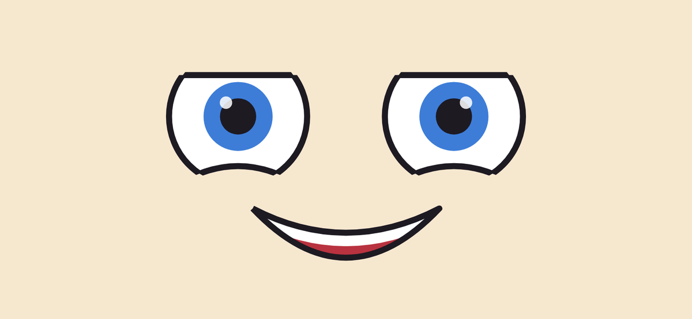 | 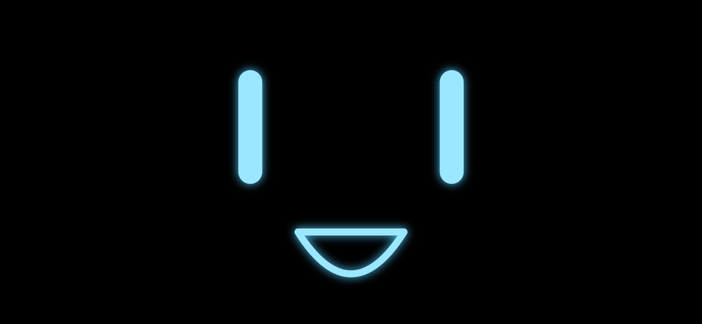 | 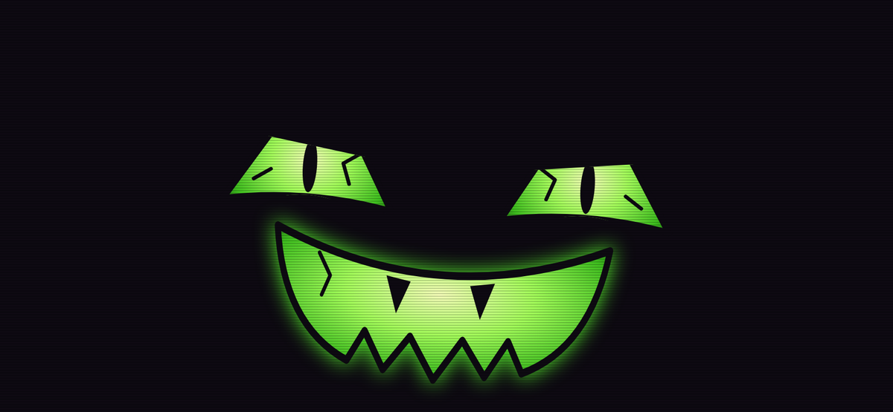 |

## Features

- **Expressive face.** 28 expressions shared by every theme (happy, curious, confused, shocked, laughing, smug, ...), blended, timed or layered; three themes: Cartoon, Minimal and Halloween.
- **Eyes and mouth that live.** Gaze on the screen or from the head's frame; idle blinking, breathing and small eye movements; a mouth driven by the robot's voice (loudness streamed at 25 Hz).
- **Subtitles.** Text on top of anything, for a robot without a speaker or an AI answer streaming in word by word; the newest three lines stay on screen, and the mouth can move with the text.
- **Pictures, video and web pages.** PNG, JPEG, animated GIF, WebP and SVG; H.264 video (loop, mute, back to the face when it ends); web pages; the face can keep running in a corner. Local files are served to the head from the host.
- **Camera view with a HUD** *(0.2)*. The front camera with a sci-fi heads-up display: boxes around faces, a locked target, compass tape, artificial horizon, battery, temperature and the robot's own lines (`display.hud`). HUD themes are JSON: `hunter`, `camcorder`, `boot`, `flight`.
- **Finds people** *(0.2)*. Several faces at once (`faces`: bearing, elevation, size, box) at 15 Hz; the eyes can follow the person in front of the robot (`look_at {frame: face}`).
- **Knows where it is** *(0.2)*. ARKit world tracking gives the head's position and orientation in the room (`pose`, 60 Hz) and follows one face with distance.
- **Knows where on Earth** *(0.3)*. GPS (`gps`, 1 Hz): latitude, longitude, altitude, accuracy, speed and course.
- **Sensors and status.** IMU up to 100 Hz in ROS conventions with a mounting offset; barometer, magnetometer and compass (`env`, 10 Hz, *0.3*); battery, thermal state, clients, what is on screen. Only sensors an iPhone 12 has: no LiDAR.
- **Safe on your network.** Pairing with a code shown on the screen, a token per client (revocable on the device), mDNS for discovery only, no cloud.
- **Tools.** Python client, `openhead` CLI, a desktop simulator that speaks the same protocol, YAML scenarios with golden screenshots, and an MCP server for AI agents.

Website: **[patrikbichis.github.io/openhead](https://patrikbichis.github.io/openhead/)** ([privacy policy](https://patrikbichis.github.io/openhead/privacy.html), [support](https://patrikbichis.github.io/openhead/support.html)). The iOS app is in TestFlight as *OpenHead Robot Face*; its store texts live in [`apps/ios/appstore/metadata`](apps/ios/appstore/metadata) and are pushed with `tools/appstore_metadata.py` (see [docs/ios.md](docs/ios.md)).

---

## Why

Robot heads usually need a screen, a camera, an IMU, a localization stack and a Wi-Fi radio. A phone already has all of them, calibrated, in one battery-backed package. OpenHead makes that package addressable from the rest of the robot without the robot having to know anything about iOS.

- **Body-agnostic.** The head knows nothing about necks, servos or wheels. It reports its own pose; the robot owns the kinematics.
- **Data-driven face.** Looks and expressions are theme packs (JSON + assets), not code. Add a cartoon look or a Halloween look by adding a folder.
- **One API, two surfaces.** Streams and commands over WebSocket for controllers; the same commands as MCP tools for agents.
- **Runs without the robot.** A desktop simulator speaks the same protocol, so controllers and agents can be developed before a single servo moves.
- **Built to be validated by an agent.** Screenshots, structured logs and scripted scenarios are part of the protocol, not an afterthought.

---

## Architecture

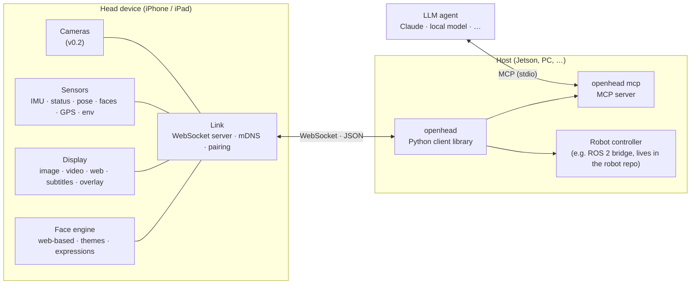

The device is the server. Hosts discover it over mDNS (`_openhead._tcp`), pair once, and connect. The robot's own code is deliberately outside this repo; it depends on the `openhead` Python package and nothing else.

---

## What the head does

| Capability | Direction | Transport | Version |
| --- | --- | --- | --- |
| Face: theme, emotion, gaze, blink, mouth envelope | host → head | commands + envelope stream (20–30 Hz) | 0.1 |
| Display: image (PNG, JPEG, GIF, WebP, SVG), video, web page, face, overlay | host → head | command; image by URL or base64, video by URL | 0.1 |
| Subtitles: text on top of anything, streamed word by word, optional moving mouth | host → head | command | 0.1 |
| Status: battery, thermal, mode, theme, emotion, link | head → host | subscription, 1 Hz | 0.1 |
| IMU: quaternion, gyro, accel in device frame | head → host | subscription, ≤ 100 Hz | 0.1 |
| Log stream and diagnostics | head → host | subscription + commands (dev mode) | 0.1 |
| Screenshot of what is on screen | host → head | command (dev mode) | 0.1 |
| Pose: position + orientation in world frame (ARKit) | head → host | subscription, ≤ 60 Hz | 0.2 |
| Faces: detected faces with bearing and size | head → host | subscription, ≤ 15 Hz | 0.2 |
| Cameras: still / clip from front or back | host → head | command, result over HTTP | 0.2 |
| GPS: latitude, longitude, altitude, accuracy, speed, course | head → host | subscription, 1 Hz | 0.3 |
| Environment: air pressure, altitude change, magnetic field, compass heading | head → host | subscription, ≤ 10 Hz | 0.3 |

Minimum iOS/iPadOS 17. Universal app, full screen on iPad.

---

## Protocol in one picture

Every message is JSON with `type`, `ts`, `seq`. Commands carry an `id` and are answered with `ack` or `error`. Streams are opened with `subscribe` and carry a requested rate, which the device may clamp. Schemas live in [`protocol/schema/`](protocol/schema/) and the protocol follows semver from `0.1.0`.

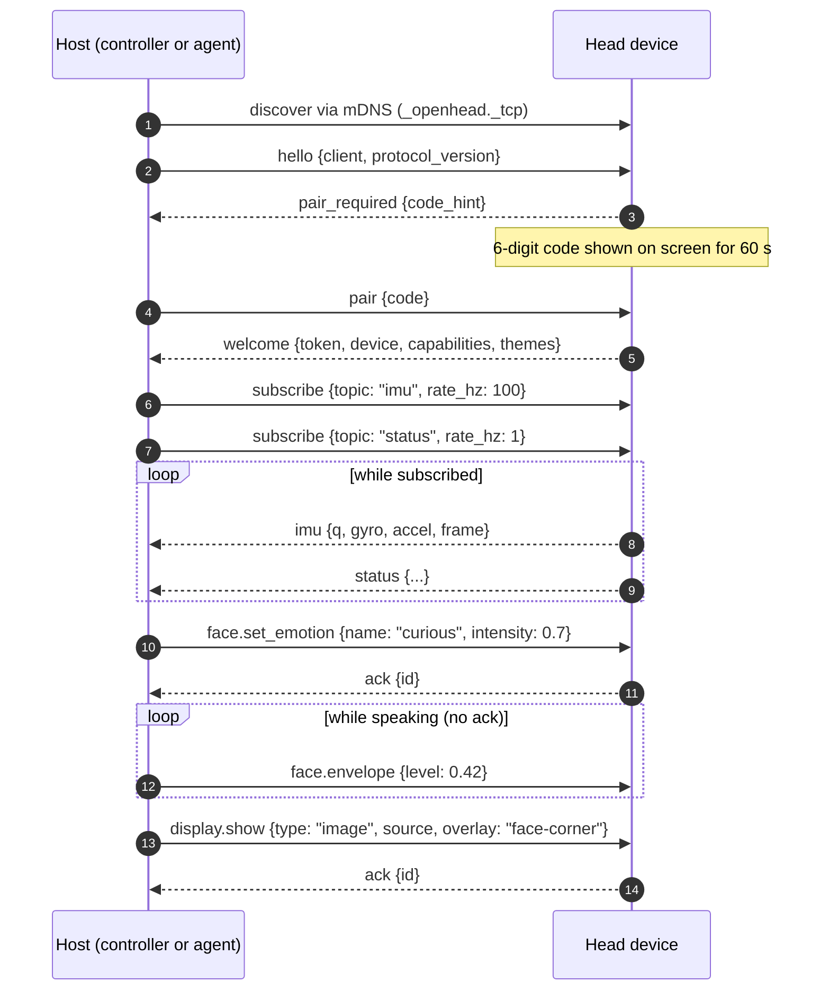

### Command families

| Family | Commands | Version |
| --- | --- | --- |
| `face.*` | `set_theme`, `set_emotion`, `look_at` (screen / head frame), `blink`, `envelope`, `list` | 0.1 |
| `display.*` | `show` (face, image, video, web), `clear`, `subtitle` | 0.1 |
| `system.*` | `status`, `screenshot`, `logs`, `diagnostics`, `settings` | 0.1 |
| `mode.*` | `set` (`idle`, `sensing`, `capture`), `get` | 0.1 (`idle` only), 0.2 |
| `pose.*` | `reset`, `save_map`, `load_map` | 0.2 |
| `camera.*` | `capture`, `stream` | 0.2 |

Error codes: `unauthorized`, `unsupported`, `busy`, `invalid_params`, `dev_mode_required`, `rate_limited`.

---

## Face engine and themes

The face is a standalone web app (TypeScript, Canvas 2D) hosted in a WKWebView on iOS and in a window in the simulator. It exposes a tiny JavaScript API (`setTheme`, `setEmotion`, `setGaze`, `setEnvelope`, `blink`, `tick`) and knows nothing about the network.

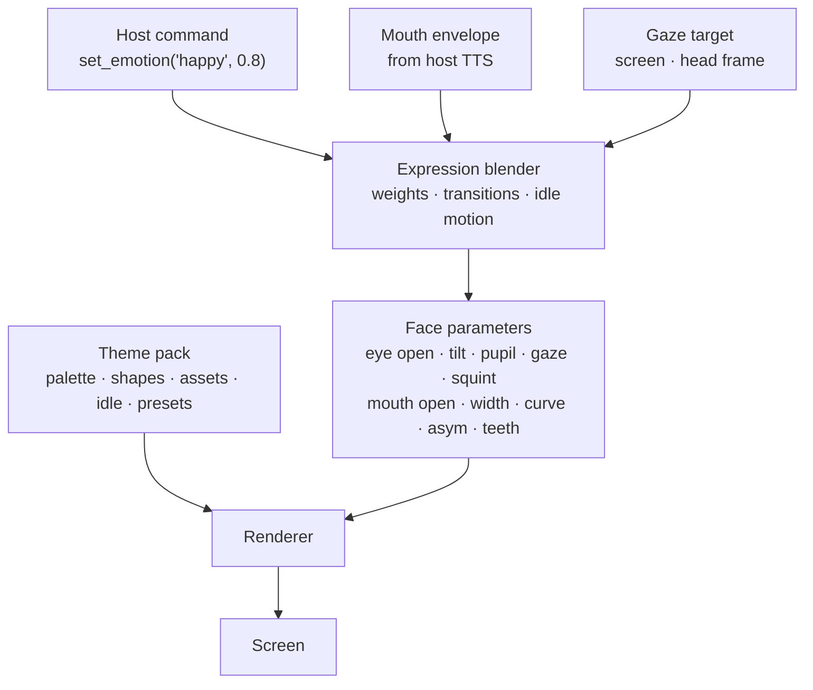

A theme is a folder:

```
face/themes/halloween/
├── theme.json        # palette, eye/mouth shapes (preset | path | image), render style, idle behaviour
├── expressions.json  # parameter preset per emotion name, plus theme-specific extras (e.g. "cackle")
└── assets/           # optional PNG/SVG for eyes, mouth, background
```

Shared emotion names, required in every theme (missing ones fall back to `neutral`):
`neutral` · `happy` · `curious` · `thinking` · `surprised` · `sad` · `angry` · `sleepy` · `scared` · `mischievous`
`confused` · `shocked` · `excited` · `bored` · `skeptical` · `worried` · `disgusted` · `embarrassed` · `proud` · `determined` · `relieved` · `annoyed` · `suspicious` · `laughing` · `disappointed` · `focused` · `nervous` · `smug`

Built-in themes in v0.1: `cartoon`, `minimal`, `halloween`. Hosts discover themes and their extra expressions with `face.list`.

### Camera view and HUD (0.2)

| Hunter | Camcorder | Flight |
| --- | --- | --- |
| 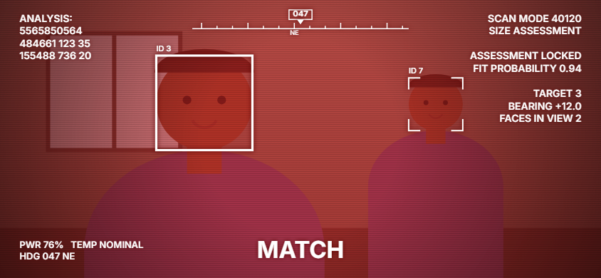 | 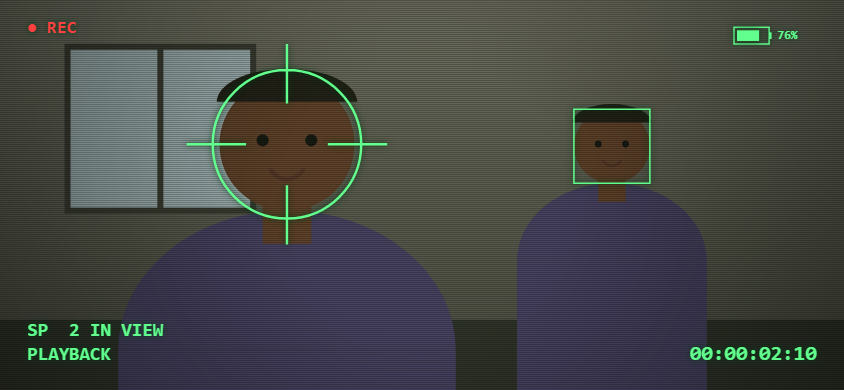 | 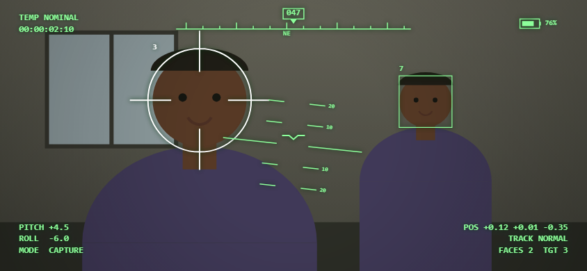 |

Two camera modes, because ARKit owns the cameras and never hands out the front camera's image: **`capture`** shows the front camera (several faces with boxes; pose only as orientation from the IMU) and **`sensing`** runs ARKit (position and orientation in the room, one face with distance, no camera image). `display.show {content: camera, hud}` switches to `capture` by itself.

```bash
openhead camera hunter --follow            # camera view with a HUD; the eyes follow the nearest face
openhead hud --set task="DELIVER CUP" --set speed=0.4 --line "TASK {task}" --line "SPEED {speed} M/S"
openhead mode sensing && openhead watch pose -n 3
```

On a real phone (iPhone 18 Pro):

| Hunter | Flight |
| --- | --- |
| 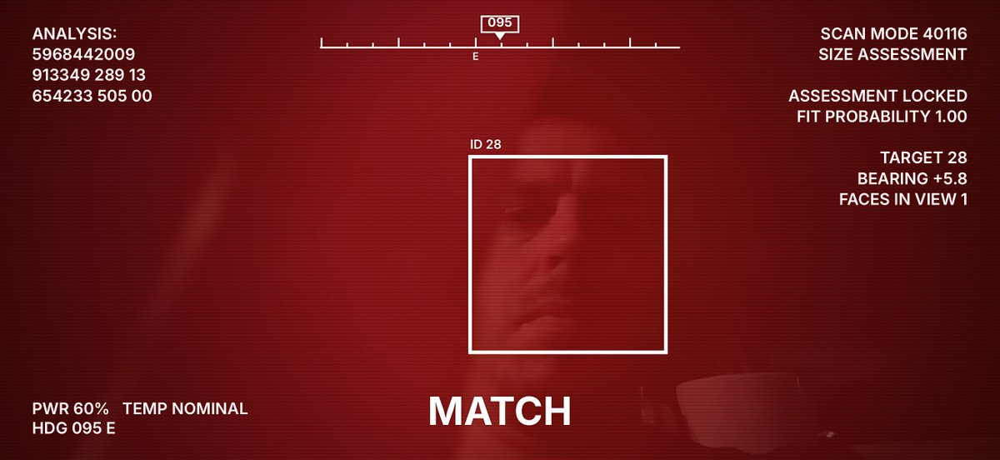 | 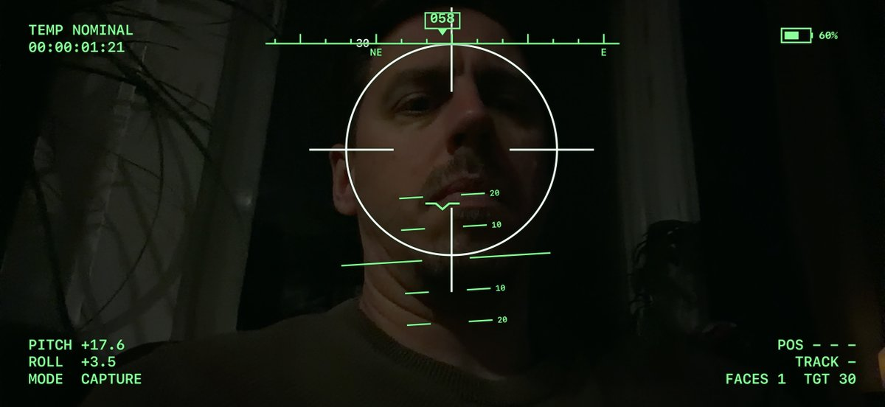 |
| **Camcorder, with the robot's own lines** | **Boot** |
| 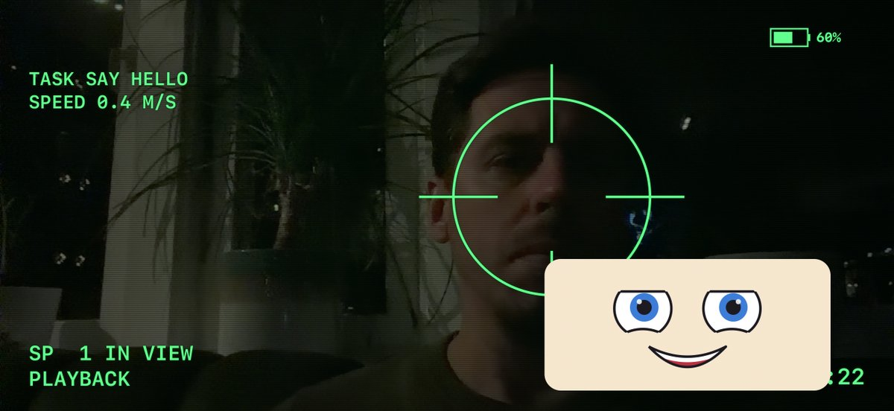 | 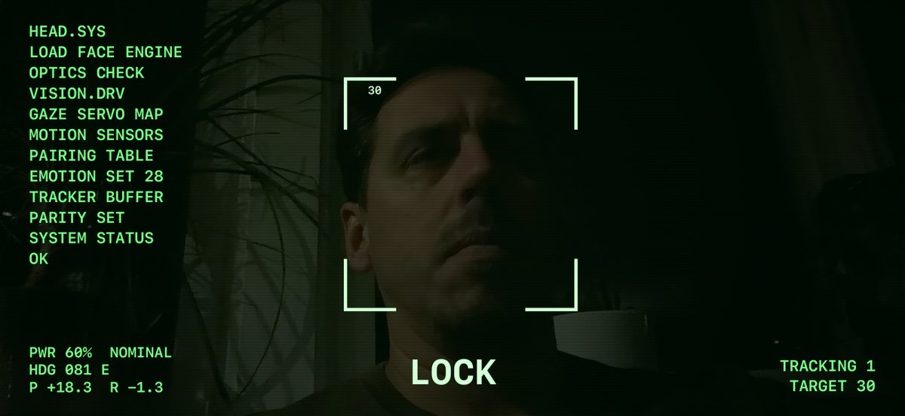 |

Sensor data recorded from the phone (tilt, acceleration, rotation, face bearing, ARKit position and path), with CSV files, is on the [website](https://patrikbichis.github.io/openhead/#sensors); `tools/sensor_plots.py` records any head (`--from-csv` redraws).

| Tilt (imu) | Face bearing (faces) | ARKit path (pose) |
| --- | --- | --- |
| 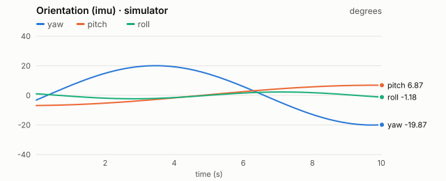 | 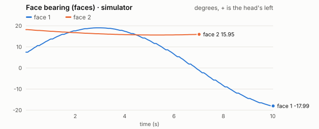 | 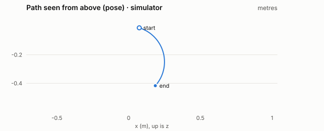 |

<details>
<summary>All 28 emotions in each theme</summary>

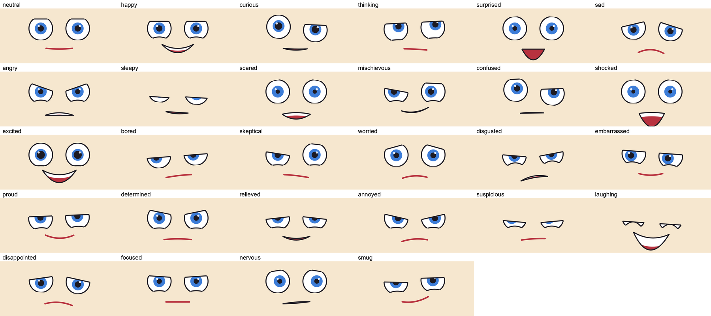
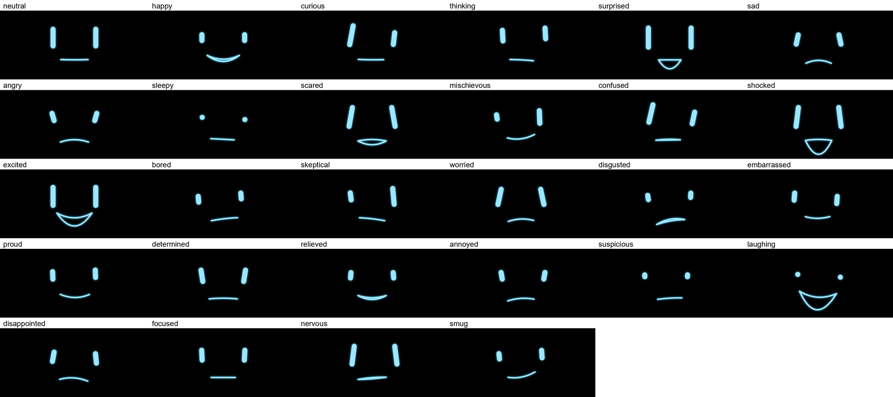
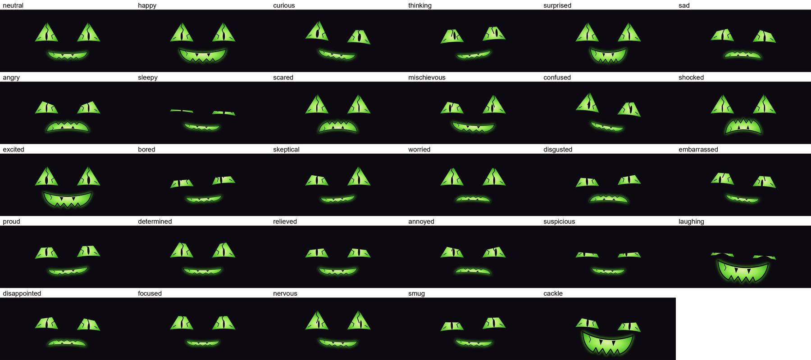

</details>

Voice is **not** part of a theme. A *persona* (theme + resting emotion + TTS voice + speaking style) is defined on the host, which is where the audio lives.

---

## MCP server

`openhead mcp` exposes the head to any MCP-capable agent using the same client library the controllers use. It is a thin adapter: no second implementation of the protocol.

| MCP | Maps to |
| --- | --- |
| Tool `pair(code)` | `pair` with the code the user reads off the device |
| Tools `list_themes`, `set_theme`, `set_emotion`, `look_at`, `look_at_face`, `show_image`, `show_video`, `show_web`, `show_camera`, `set_hud`, `show_face`, `subtitle` | `face.*`, `display.*` |
| Tools `set_mode`, `get_faces`, `get_pose` | `mode.*`, `faces`, `pose` (0.2) |
| Tools `get_location`, `get_environment` | `gps`, `env` (0.3) |
| Tools `get_status`, `take_screenshot` (returns image), `tail_logs`, `get_diagnostics` | `system.*` (dev mode required for the last three) |
| Tool `wait_for(topic, predicate, timeout_s)` | A subscription that returns on first match (`status`, `log`; `faces` in 0.2) |
| Tool `run_scenario(path)` | Runs a YAML scenario and returns the report with screenshots |
| Resources `openhead://status`, `openhead://themes`, `openhead://logs` | Latest cached value |

High-rate streams (IMU, envelope) are intentionally not exposed over MCP; use the WebSocket API. Transport is stdio in v0.1; Streamable HTTP is planned for v0.2.

```bash
openhead mcp --device auto        # stdio, for Claude Code / Claude Desktop / local agents
openhead mcp --selftest           # every tool against a headless simulator
```

---

## Developer loop

The head is built to be validated by an agent, not only by a person holding the phone. The same scenario runs at three levels.

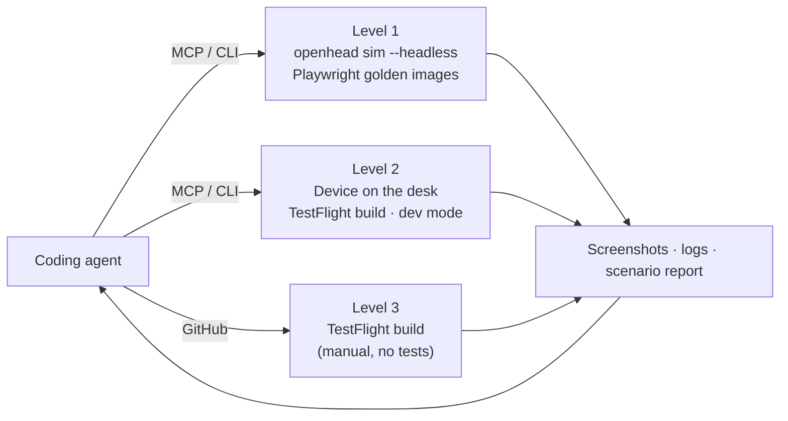

- `take_screenshot` returns what is on the screen as an image.
- `tail_logs` streams the app's structured log; every received command is logged with its `seq`.
- `run_scenario` executes a YAML scenario (set theme, set emotion, wait, screenshot, assert on log and status) against the simulator or a real device.
- Screenshot, logs and diagnostics answer only when **dev mode** is enabled in the app's settings.

```yaml
name: halloween-scared
steps:
  - set_theme: halloween
  - set_emotion: { name: scared, intensity: 1.0 }
  - wait_ms: 600
  - screenshot: halloween-scared.png
  - expect_status: { theme: halloween, emotion: scared }
```

See [`docs/dev-loop.md`](docs/dev-loop.md).

---

## Security

- Pairing: the device shows a 6-digit code for 60 s when an unknown client connects. A correct code yields a per-client token (Keychain on the device, `~/.openhead/tokens.json` on the host). Five failed attempts lock pairing for five minutes.
- All commands and subscriptions require a valid token. mDNS advertises name and port only.
- Dev mode gates `system.screenshot`, `system.logs`, `system.diagnostics` and `settings.set`. Off by default; shown as an icon in the status bar.
- Screenshot and photo URLs are served by the device over HTTP with the token in a header and expire after 60 s.
- No TLS in v0.1; the network is assumed private. TLS is planned for v0.2 and advertised through `capabilities`.
- Clients can be revoked in the app's settings. The MCP server is a client like any other.

---

## Repository layout

```
openhead/
├── protocol/
│   ├── schema/             # JSON Schema (2020-12): envelope, commands/, topics/, theme.schema.json
│   ├── VERSION             # 0.1.0 – also drives the app's MARKETING_VERSION
│   ├── CHANGELOG.md
│   └── docs/               # generated reference
├── face/                   # face engine (TypeScript + Canvas, Vite)
│   ├── src/
│   ├── themes/             # cartoon/ minimal/ halloween/
│   └── tests/              # Playwright golden images: theme × emotion, images, video, subtitles, animation
├── apps/ios/               # SwiftUI shell; project.yml for XcodeGen
│   ├── OpenHead/           # App/ Link/ Sensors/ Display/ Face/ Settings/ Logging/
│   ├── OpenHeadTests/
│   └── OpenHeadUITests/    # XCUITest with screenshots
├── python/                 # one package: openhead (extras: [mcp], [sim])
│   └── src/openhead/
│       ├── protocol/       # pydantic models generated from schema
│       ├── client/         # asyncio client
│       ├── sim/            # simulator: server + window running face/dist
│       ├── mcp/            # MCP server
│       └── cli/            # openhead discover|pair|screenshot|logs|emotion|theme|show|run|sim|mcp
├── scenarios/              # YAML scenarios, run against simulator and device
├── examples/
├── docs/                   # ios.md · dev-loop.md · themes.md
├── tools/                  # protocol.py · check.py (all local tests) · apple_setup.py
└── .github/workflows/      # ios-testflight (manual; the only workflow)
```

Python and Swift models are generated from the schemas by `tools/protocol.py` and committed; hand-written copies are not allowed. All testing runs locally (`tools/check.py`, also as the pre-push hook); GitHub Actions only builds the iOS app and uploads it to TestFlight. The face bundle is built in that workflow and copied into the app before each build.

---

## Quick start

**Without hardware**

```bash
cd face && npm ci && npm run build && cd ..   # the face engine the simulator renders
cd python && uv sync && uv run playwright install chromium
uv run openhead sim                           # simulated head with a face window (pairing code 0000)
uv run openhead pair 0000 --device localhost  # in a second terminal
uv run openhead emotion curious --device localhost
uv run openhead screenshot -o face.png --device localhost
uv run openhead run ../scenarios/smoke.yaml --device localhost
uv run openhead mcp --device localhost        # expose it to an agent (step 5)
```

**With an iPhone or iPad**

1. Install the app from TestFlight (see [`docs/ios.md`](docs/ios.md)) and put the device on the same Wi-Fi as the host.
2. Open the app; it shows a pairing code when the first client connects.
3. `openhead discover`, then `openhead pair --device head-01.local`: connecting makes the head show a code for 60 s; type it at the prompt.
4. `openhead run scenarios/smoke.yaml --device head-01.local`.

---

## On the phone

Mount the phone in landscape and start the app: the face fills the screen. A long press (1.5 s) opens the settings; when a new client connects, a pairing code is shown for 60 s.

| Connection | Head |
| --- | --- |
| 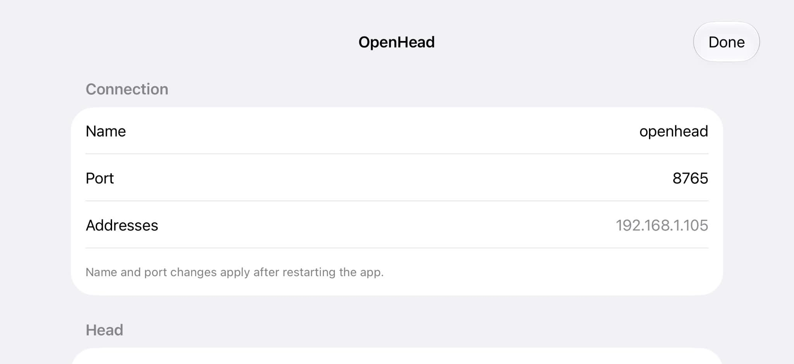 | 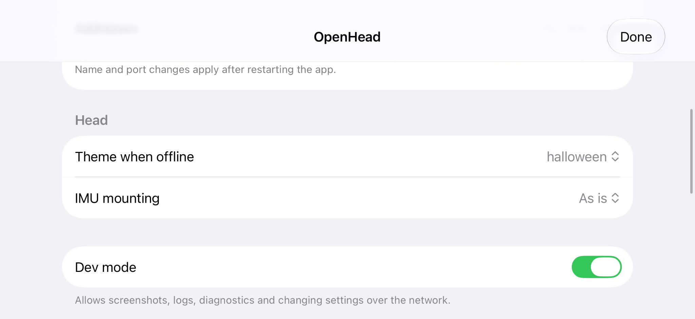 |
| **Dev mode and paired clients** | **About** |
| 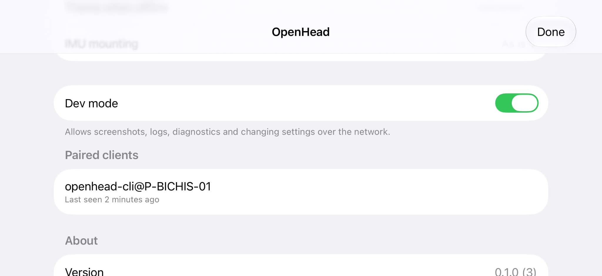 | 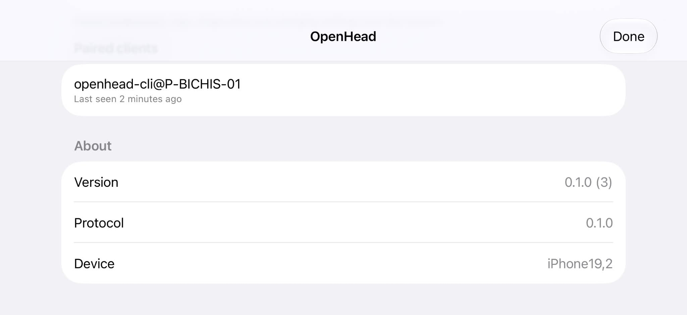 |

---

## Device support

| Device | Face | IMU / status | World pose (0.2) | Face tracking (0.2) | GPS / env (0.3) |
| --- | --- | --- | --- | --- | --- |
| iPhone 12 and later | yes | yes | ARKit, back camera | front camera, concurrent with world tracking (A12+) | GNSS, barometer, magnetometer, compass |
| iPad mini (5th gen+) | yes | yes | ARKit | on-device vision | Wi-Fi location (GNSS on cellular models), barometer, compass |
| iPad (7th gen+) | yes | yes | ARKit | on-device vision | Wi-Fi location (GNSS on cellular models), barometer, compass |
| Desktop simulator | yes | synthetic | synthetic | synthetic | synthetic |

---

## Status

Protocol `0.2.0` is tagged ([release](https://github.com/PatrikBichis/openhead/releases/tag/v0.2.0)): camera view with HUD, faces and ARKit pose on top of 0.1. Robot integrations pin a tag.

- [x] 1. Repo skeleton, local schema validation
- [x] 2. Protocol schemas 0.1 with generated models and docs
- [x] 3. Face engine with three themes and golden-image tests
- [x] 4. Simulator, Python client, CLI, smoke scenario
- [x] 5. MCP server (stdio)
- [x] 6. Apple Developer setup and secrets
- [x] 7. iOS shell: link, pairing, face, status, settings, logs, screenshot → first TestFlight build
- [x] 8. Device in the loop: smoke scenario green on simulator and device
- [ ] 9. IMU stream and envelope-driven mouth
- [x] 10. Video, subtitles and a display test suite
- [x] 11. Tag `0.1.0` (iPhone 12 and iPad checks still open, see release notes)
- [x] 12. v0.2: camera view with HUD themes, faces, ARKit pose, modes (`camera.yaml` green on simulator and iPhone)
- [ ] 13. v0.3: `gps` and `env` streams (green on the simulator; device check and tag open)

---

## License

Apache 2.0 (proposed). See [`LICENSE`](LICENSE).
